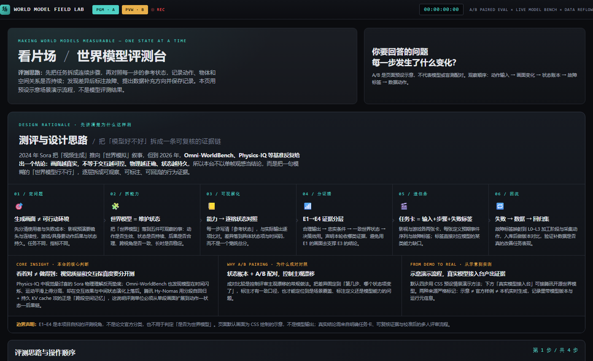
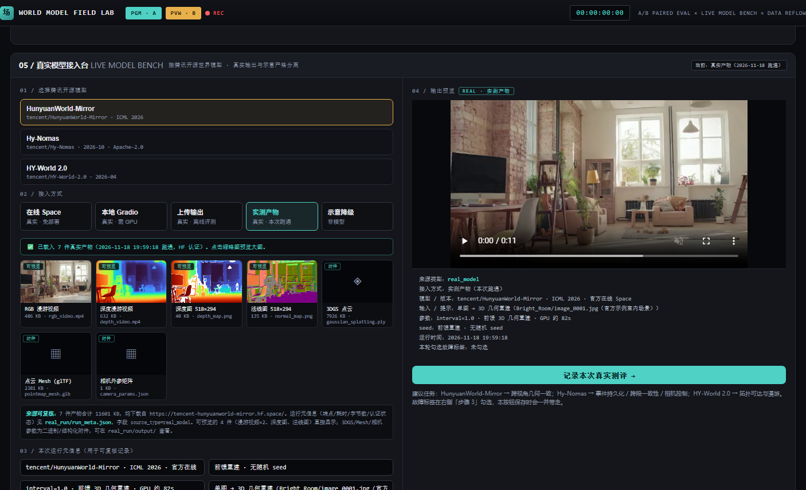
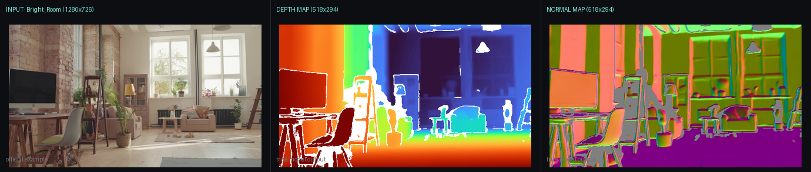

# 看片场 · 世界模型评测台（World Model Field Lab）

> 在线体验：https://daisyyy-ls.github.io/world-model-playground/
> 最后更新 2026-11-18

一个**可交互的世界模型评测台**。它做两件事：

1. **方法层**：把「世界模型好不好」这种模糊问题，拆成一条可观察、可复核、可分层的证据链，做成能上手的界面；
2. **证据层**：v7 起**真实跑通了腾讯开源世界模型 HunyuanWorld-Mirror**，把 7 件真实产物接入页面，真实记录与 CSS 示意在数据中严格分列。

> 一句话主张：对世界模型，除了「画面看起来对不对」，更要问「动作有没有生效、状态有没有持续、结果有没有保持一致」。2026 年的公开基准（Omni-WorldBench、Physics-IQ 等）反复证实——**视觉质量与交互保真度是两回事**。

---

## 一、整体思路：为什么这样设计

### 1.1 从评测问题出发

评测工作的核心不是「给模型打分」，而是**把模糊的主观感受翻译成可采集、可复核、可回流的数据**。所以这个台子的设计不是从「有哪些指标」开始，而是从一条因果链开始：

```
模型能力  →  可观察行为  →  逐帧证据  →  故障标签  →  数据加工动作
（不可直接测）  （能测什么）   （拿什么证明）  （错在哪）    （下次怎么补数据）
```

这条链决定了产品的每一层：测什么维度、界面怎么呈现、导出什么字段。

### 1.2 测评与设计的六步法（页面最前章节）

页面 Hero 之后第一屏就是完整的「测评与设计思路」，把方法论摆在交互之上：

| 步骤 | 做什么 | 为什么 |
|---|---|---|
| 01 定问题 | 分清「生成画面」与「可行动环境」 | 使用者不同、失败成本不同、指标就不同 |
| 02 拆能力 | 把"世界模型"落到 5 件可观察的事：动作生效、状态持续、后果合理、跨视角一致、长时稳定 | 不可测的"智能"要降维成可测的行为 |
| 03 可观察化 | 每步写清「参考状态」，与实际输出逐项比对 | 差异要落到状态项和帧上，不能停在"感觉不对" |
| 04 分证据 | E1 合理输出 → E2 忠实条件 → E3 一致状态 → E4 决策效用 | 防止用"画面好看"去支撑"有世界模型"这种过强结论 |
| 05 造任务 | 影视/游戏任务卡定义输入、步骤、预期、故障标签 | 任务是可复现的最小评测单元 |
| 06 回流 | 故障标签 → L0–L3 加工阶段 + 回归集 | 让每次评测指向下一次数据采集 |

**三条贯穿始终的判断**：

- **看着对 ≠ 做得到**（视觉质量与交互保真分离）；
- **A/B 配对 + 状态账本控制主观漂移**（配对比较是控制评审漂移的标准做法）；
- **示意演示流程、真实模型产出证据，两者严格分离**（数据诚信，见第五节）。

### 1.3 对世界模型的技术理解（维度为什么这样定）

维度表不是凭空列的，而是跟着模型架构走的。这是本台相对旧版最重要的升级：

- **视觉质量不等于交互保真**：Omni-WorldBench、Physics-IQ 的结论是，视频看起来真实的模型，在物理因果、状态持续上仍大量失败。因此 E3（一致世界状态）被单列为关键证据档。
- **架构决定失败模式**：Hy-Nomas 采用**分段自回归 + 持久 KV cache**，每段都可能漂移，段边界是否连续直接决定能否长时交互——所以 v7 新增「**跨段一致性**」维度，旧 8 维没有这一项。
- **不同技术路线测不同东西**：前馈式 3D 重建（HunyuanWorld-Mirror，输入图 → 深度/法线/3DGS）天然适合测**跨视角几何一致**；交互式视频模型（Hy-Nomas）适合测**动作生效、事件持久化、长时记忆**；多模态 3D（HY-World 2.0）适合测**拓扑可达性**。页面里每个维度名悬停都会显示它对应的真实模型/基准。

---

## 二、界面长什么样（图片示例）

### 2.1 测评与设计思路（首屏）


*图 1：Hero +「测评与设计思路」六步法 + 三条核心判断。方法论先于交互呈现。*

### 2.2 真实模型接入台 · 实测产物模式


*图 2：「05 真实模型接入台」的「实测产物」模式。右侧是腾讯官方模型真实生成的 3DGS 漫游视频，左侧 7 张卡片是本次真实跑通的全部产物；来源徽章 `REAL · 实测产物`，元信息自动填入真实端点、参数与运行时间。*

### 2.3 真实产物：输入 vs 深度图 vs 法线图


*图 3：左为输入（官方示例室内图 1280×726），中为模型输出的深度图，右为法线图（均 518×294）。深度图里近处桌椅呈暖色、远处呈冷色；法线图里不同朝向的表面呈不同颜色——这是前馈 3D 重建模型的典型输出，不是输入图的滤镜或回显。*

> 界面风格：导演台 / 导播台深色控制台（PGM·PVW 双监视器、安全框、时间码、传输控制键）。默认四步引导：选任务 → 逐步观察 A/B 与状态账本 → 标注差异 → 保存导出；证据档位与找茬挑战默认折叠，可跳过。

---

## 三、真实实测：跑通了什么

### 3.1 调用链

用 HF 认证调用腾讯官方开源模型 `tencent/HunyuanWorld-Mirror`（Gradio 5.49.1，ICML 2026）的真实在线 Space，本地机器是 RTX 2050 4GB（跑不动，所以走云端 ZeroGPU）：

```
上传官方示例室内图 (1280×726)
   → /update_gallery_on_file_upload  (云端视角采样, 6.8s)
   → /gradio_demo                    (云端 GPU 3D 重建, 82.4s)
   → 下载 7 件真实产物 (约 12MB) 到 real_run/output/
```

`real_run/run_meta.json` 记录 `status=success` / `source_type=real_model` / 端点 / 耗时 / 每件产物字节数，可逐字段复核。

### 3.2 产物清单与真实性校验

| 产物 | 规格 | 大小 | 真实性证据 |
|---|---|---|---|
| `rgb_video.mp4` / `depth_video.mp4` | 3DGS 漫游 / 深度漫游 | 486 / 633 KB | 文件头 `ftypisom`，合法 MP4 |
| `depth_map.png` | 518×294 RGB | 41 KB | 尺寸≠输入图；亮度 std=63.7，有真实深度层次 |
| `normal_map.png` | 518×294 RGB | 135 KB | 三通道 std≈55–60，法线方向有真实变化 |
| `gaussian_splatting.ply` | **119,351 个高斯基元** | 8.1 MB | `ply` + `binary_little_endian` 文件头 |
| `pointmap_mesh.glb` | glTF 2.0 Mesh | 2.4 MB | `glTF` 魔数 |
| `camera_params.json` | 1 相机内外参 | 945 B | fx≈536、主点(259,147)，与 518×294 匹配 |

**3DGS 结构（体现模型理解）**：PLY 每个高斯点有 17 个 float 属性——`x,y,z`（位置）、`nx,ny,nz`（法线）、`f_dc_0/1/2`（球谐直流项，编码颜色）、`opacity`（不透明度）、`scale_0/1/2`（三个轴的尺度）、`rot_0/1/2/3`（四元数旋转）。这正是 3D Gaussian Splatting 的标准表示：用大量可微的各向异性高斯椭球显式建模场景，而不是 NeRF 那种隐式场。

**相机参数的合理解读**：外参矩阵接近单位阵（旋转≈单位、平移≈0），内参 fx≈536、fy≈537、主点(259,147)。这是**单图前馈重建**的预期结果——只有一张图、没有视差基线，模型只能把输入图坐标系当作参考帧，输出的是相对深度与初始位姿，而不是多视图 SfM 解算出的绝对轨迹。把它说成"相机位姿估计的实测结果"是不诚实的，这里如实标注。

### 3.3 从失败到跑通（这部分比结果更值钱）

- 本地 **RTX 2050 4GB** 无法加载模型（官方要求 4090 级 + CUDA 12.4）→ 改走云端 Space；
- HuggingFace 直连超时 → 改用 `hf-mirror.com` 下载示例图；
- 沙箱代理让 gradio_client 报 **502** → 清除代理环境变量后直连；
- 匿名 ZeroGPU 配额被拦：`180s requested vs. 123s left` → 换镜像、降采样帧、预置接口、腾讯国内站均无法绕过 → 最终用**免费 HF token** 把配额提到 300 秒/天；
- SDK 参数坑：`Client(token=...)` 而非 `hf_token`；
- 产物保存 bug：`FileData.video` 有时是字符串路径 → 修复后重跑，拿到含视频的全部 7 件产物。

完整排查记录见 [`real_run/README.md`](real_run/README.md)。**能讲清楚"链路怎么打通、卡在哪、怎么解决"，是评测岗面试里比单个结果更有说服力的能力证据。**

---

## 四、实现方法

### 4.1 测评台（前端，单文件）

`index.html` 是零依赖的静态单文件（约 115 KB），原生 JS：

- **数据结构**：任务卡 `CASES`（影视/游戏 2 轨 4 任务）、9 维剖面 `DIMS`、故障标签 `TAGS`（中文名 + 建议加工阶段 + 采集动作）、模型配置 `LIVE_MODELS`、真实产物清单 `REAL_ARTIFACTS`；
- **状态账本**：每步记录参考状态与实际状态，B 情景与参考不符的格子标 ✕，差异驱动评分与标签；
- **证据分层**：E1–E4 是本项目自拟的评测视角（参考 [arXiv:2610.31668](https://arxiv.org/abs/2610.31668) 对视频/世界状态的讨论），**不是论文官方分类**；
- **持久化**：记录写 localStorage，JSON/CSV 导出（CSV 带 BOM、公式前缀转义）；每条记录带 `source_type`、`source_mode`、模型、端点、提示词、seed、参数等元信息。

### 4.2 真实推理（脚本）

`real_run/run_inference.py`：清代理 → 连官方 Space → 两步 predict → 下载产物 → 写 `run_meta.json`。已登录用户可省略 token（脚本自动读 HF 缓存）。字段与主测评台 `records` 导入格式对齐。

### 4.3 真实性分离机制

`source_type=real_model`（真实模型/产物）与 `source_type=schematic`（CSS 示意）在记录表用 `REAL`/`示意` 徽章区分，在导出中分列。**任何情况下都不把预设示意或输入回显冒充模型输出**——早期一张被误存的输出经 md5 校验发现与输入完全一致，已删除并在文档中说明。

---

## 五、局限性与没有做到的地方（诚实清单）

**关于真实推理：**

1. **只跑了 1 组样本、1 个任务**：用的是官方示例图的单图 3D 重建，**不是**任务卡里的四条交互任务。没有多视图输入、没有视频输入、没有交互式 rollout。
2. **不测交互能力**：HunyuanWorld-Mirror 是前馈 3D 重建模型，本身不产生动作条件视频。动作生效、事件持久化、跨段一致性这些维度，本次真实产物**无法验证**——它们目前仍是方法设计和示意演示。
3. **没有客观指标对比**：没有 FVD / LPIPS / PSNR 等指标，没有和 Genie 3、Cosmos 等其他模型对照。深度图/法线图的分析是定性观察 + 基础统计，不构成质量评分。
4. **相机参数不能过度解读**：单图重建的位姿接近单位阵，不能当作"位姿估计能力"的证据（见 3.2）。
5. **未实跑 Hy-Nomas / HY-World 2.0**：页面给了官方入口与接入通道，但没有真实产出它们的结果。

**关于评测方法：**

6. **没有多人一致性**：没有 Cohen's κ / Krippendorff's α，找茬挑战的分数不能证明标注员培训有效。单人标注不是数据。
7. **A/B 默认情景是 CSS 预设**：不是真实模型输出；真实产物只在「实测产物」模式里出现。
8. **没有大样本与回归集**：分数仅供流程演示与问题定位，不是 benchmark 结论，也不能推断模型内部表征或证明它"拥有世界模型"。
9. **E1–E4 档位自拟**：不是论文官方分类，也不是判定标准。

**关于工程：**

10. **页面无后端**：记录存本地浏览器，无协作、无多人共享、无服务端存储。
11. **依赖在线服务**：真实产物来自 HF Space 免费额度，服务状态与配额会变化；复现前需确认可用。

---

## 六、复现

```bash
# 页面（真实产物预览需通过本地服务器，不能 file:// 双击）
python -m http.server 8000   # 打开 http://localhost:8000

# 真实推理（需 HF 账号的免费 READ token）
python real_run/run_inference.py --token hf_xxx
# 已 `hf auth login` 过可省略 --token
```

产物 → `real_run/output/`，元信息 → `real_run/run_meta.json`，页面 → 「05 真实模型接入台」→「实测产物」。

---

## 配套仓库

- [world-model-data-kit](https://github.com/Daisyyy-LS/world-model-data-kit) — 调研 + 8 维打分 → 数据回流 + 论文地图 + Hy-Nomas 上手与评测计划
- [cinematic-shot-spec](https://github.com/Daisyyy-LS/cinematic-shot-spec) — 影视分镜语言 → 可计算相机参数 + 越轴/景别自动检查

三者构成一条主张：**先把场景约束翻译成任务和标签，再让每一次评测都指向一次数据采集。**

详细路线图与缺口见 [`ROADMAP.md`](ROADMAP.md)，模型进展观察见 [`research-note.md`](research-note.md)。
